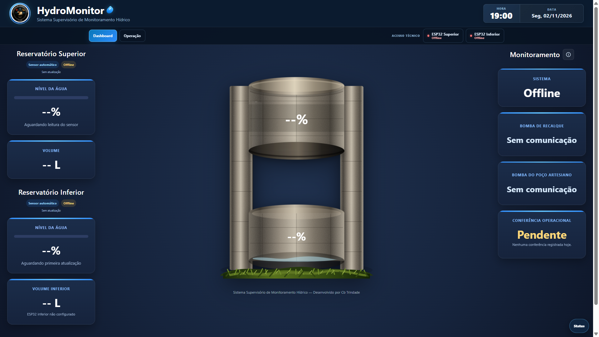

# 🌊 Hidromonitor — Sistema IoT de Monitoramento de Reservatórios

[](https://opensource.org/licenses/MIT)


O **Hidromonitor** é uma solução open-source baseada em IoT (Internet das Coisas) para monitoramento em tempo real do nível de água em reservatórios e tanques. O sistema coleta dados por meio de um microcontrolador ESP32 e sensores ultrassônicos, exibindo as métricas em uma interface web acessível via rede local.

---

## 📌 Funcionalidades

- 📏 **Leitura em Tempo Real:** Medição precisa da distância da lâmina d'água via sensor ultrassônico.
- 📊 **Dashboard Web:** Interface responsiva em HTML/CSS para visualização gráfica do percentual de volume disponível.
- ⚠️ **Alertas de Nível:** Sinalização visual para níveis crítico, alerta e operacional.
- 🔄 **Automação de Acionamento:** Lógica para controle de relé/bomba d'água evitando transbordamento ou funcionamento a seco.

---

## 🛠️ Tecnologias Utilizadas

- **Microcontrolador:** ESP32 (Wi-Fi integrado)
- **Linguagem de Programação:** C++ (Arduino Framework)
- **Sensor:** Ultrassônico HC-SR04
- **Interface Web:** HTML5, CSS3, JavaScript
- **Protocolos:** HTTP / WebServer embutido

---

## 🚀 Como Executar o Projeto Localmente

### Pré-requisitos
- [Arduino IDE](https://www.arduino.cc/en/software) ou extensão [PlatformIO](https://platformio.org/) no VS Code.
- Driver **CP210x** ou **CH340** instalado para comunicação USB com o ESP32.


---

## 📷 Demonstração da Interface



---

### Passo a Passo

1. **Clonar o repositório:**
   ```bash
   git clone [https://github.com/IgorFreitasES/Hidromonitor.git](https://github.com/IgorFreitasES/Hidromonitor.git)
   cd Hidromonitor
